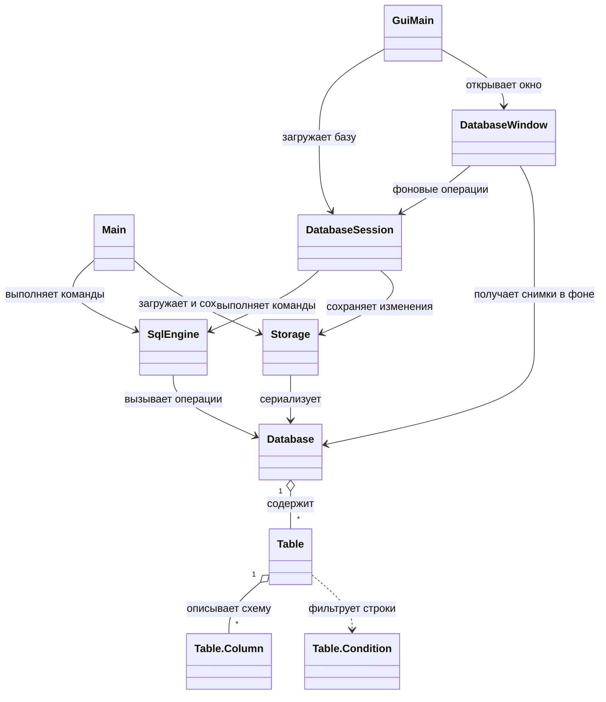
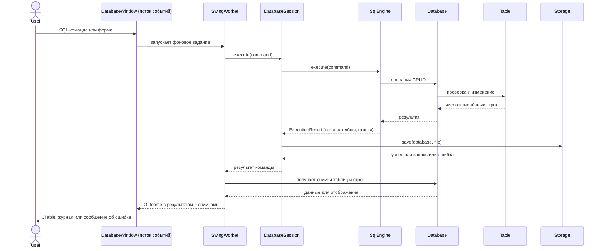

# Simple DBMS

Учебная упрощённая система управления базами данных на Java с графическим интерфейсом Swing и консолью. Приложение принимает SQL-подобные команды, проверяет типы и ограничения, сохраняет данные и индексы на диск и восстанавливает их при следующем запуске.

## Возможности

- таблицы со столбцами `INTEGER`, `DOUBLE`, `STRING`, `DATE`, `BOOLEAN`;
- уникальный первичный ключ и внешний ключ между таблицами;
- `INSERT`, `SELECT`, `UPDATE`, `DELETE`;
- дополнительные команды `CREATE TABLE`, `DROP TABLE`, `CREATE INDEX`;
- вставка нескольких строк одной командой;
- табличный вывод результата `SELECT`;
- графический просмотр таблиц, схемы, связей и индексов;
- формы добавления, изменения и удаления записей;
- SQL-редактор с выполнением нескольких команд и журналом результатов;
- сохранение после каждого изменения;
- резервная копия и восстановление при повреждении основного файла;
- индексированный поиск по условию равенства.

## Требования и запуск

Нужен JDK 17 или новее и PowerShell 5.1 или новее.

```powershell
.\scripts\gui.ps1
```

Скрипт сам собирает проект и открывает GUI. В IntelliJ IDEA можно запустить метод `main` класса `GuiMain`; рабочий каталог — корень проекта. Swing входит в JDK, внешние зависимости не нужны. Для отдельного файла базы:

```powershell
.\scripts\gui.ps1 -DatabaseFile 'data/demo.bin'
```

Консоль и отдельная сборка:

```powershell
.\scripts\build.ps1
.\scripts\run.ps1
```

В консоли команда `help` выводит примеры, а `exit` или `quit` завершает работу. Консоль принимает одну SQL-команду на строку; многострочные команды и скрипты выполняются в GUI. Оба интерфейса по умолчанию используют `data/database.bin` в корне проекта. После замены существующего файла его предыдущая версия хранится в `data/database.bin.bak`. При отсутствии или повреждении основного файла исправная резервная копия восстанавливает основной файл перед дальнейшими сохранениями.

Сохранение сначала записывает данные во временный файл с суффиксом `.tmp`, затем заменяет основной файл. Замена атомарна, если файловая система поддерживает `ATOMIC_MOVE`; иначе выполняется обычная замена без гарантии атомарности.

Дополнительные команды разработки:

```powershell
.\scripts\test.ps1
.\scripts\test-gui.ps1
.\scripts\javadoc.ps1
.\scripts\performance.ps1
```

Javadoc создаётся в `out/docs`.

## Работа в графическом интерфейсе

1. Выберите `brands` слева. Нажмите **Добавить запись…**, заполните `id` и `name`. Сначала создайте бренд, затем добавьте автомобиль в `cars` с существующим `brand_id`.
2. Вкладка **Данные** показывает всю выбранную таблицу. Щелчок по заголовку сортирует записи. Для изменения или удаления выделите строку на этой вкладке и нажмите соответствующую кнопку. Первичный ключ при редактировании фиксирован.
3. Введите SQL в редакторе или выберите шаблон в **Примеры команд…**. Нажмите **Выполнить** или `Ctrl+Enter`. Если текст выделен, выполняется только выделение. Несколько команд разделяются точками с запятой; точки с запятой внутри строк учитываются корректно.
4. Результат `SELECT` открывается на вкладке **Результат SQL**. Заголовки сохраняются и при пустой выборке. В **Журнале** видны команды, ответы, время выполнения и применение индекса.
5. **Создать индекс…** позволяет выбрать столбец и имя индекса. После этого запрос с условием равенства по этому столбцу использует индекс.
6. **Создать таблицу…** вставляет в редактор шаблон `CREATE TABLE`, который можно изменить и выполнить. `DROP TABLE` доступен через SQL.

Строки в формах вводятся без SQL-кавычек; апострофы экранируются автоматически. Дата имеет формат `YYYY-MM-DD`. У необязательных столбцов есть флажок `NULL`, обязательные поля отмечены `*` или `[PK]`.

Изменения автоматически сохраняются после каждой успешной команды. При ошибке сохранения окно показывает несохранённое состояние; кнопка **Сохранить** повторяет запись. Закрытие окна с несохранёнными изменениями предлагает сохранить их или выйти. Во время запроса окно остаётся отзывчивым, действия с базой временно недоступны.

SQL-скрипт выполняется последовательно и останавливается при первой ошибке. Предыдущие успешные команды сохраняются; скрипт целиком не является транзакцией.

## Предметная область и схема

Предметная область — **каталог автомобилей автосалона**. Система хранит сведения о марках (брендах) автомобилей и о конкретных моделях, которые продаются в салоне: цену, дату выпуска и наличие.

По умолчанию создаются две связанные таблицы.

### Бренд — `brands`

Производитель автомобилей.

| Столбец | Тип | Ограничения | Описание |
| --- | --- | --- | --- |
| `id` | `INTEGER` | `PRIMARY KEY` | Уникальный идентификатор бренда |
| `name` | `STRING` | | Название бренда, например «Toyota», «BMW» |

### Автомобиль — `cars`

Конкретная позиция в каталоге.

| Столбец | Тип | Ограничения | Описание |
| --- | --- | --- | --- |
| `id` | `INTEGER` | `PRIMARY KEY` | Уникальный идентификатор автомобиля |
| `brand_id` | `INTEGER` | `FOREIGN KEY → brands.id` | Идентификатор бренда |
| `model` | `STRING` | | Название модели, например «Camry», «X5» |
| `price` | `DOUBLE` | | Цена автомобиля |
| `manufactured` | `DATE` | | Дата выпуска в формате `YYYY-MM-DD` |
| `available` | `BOOLEAN` | | Есть ли автомобиль в наличии |


По умолчанию создаются две связанные таблицы автомобилей:

| Таблица | Столбцы | Первичный ключ | Внешний ключ |
| --- | --- | --- | --- |
| `brands` | `id INTEGER`, `name STRING` | `id` | — |
| `cars` | `id INTEGER`, `brand_id INTEGER`, `model STRING`, `price DOUBLE`, `manufactured DATE`, `available BOOLEAN` | `id` | `brand_id → brands.id` |

Нельзя добавить автомобиль с отсутствующим брендом или удалить бренд, пока на него ссылаются автомобили.

## Примеры команд

Пример рассчитан на новую базу с пустыми таблицами `brands` и `cars`: весь блок можно выполнить в SQL-редакторе GUI. В консоли вводите команды по отдельности, каждую целиком на одной строке, включая `INSERT` с несколькими записями. Для повторного выполнения нужны свободные первичные ключи и новое имя индекса.

```sql
INSERT INTO brands VALUES (1, 'Toyota');
INSERT INTO cars VALUES (1, 1, 'Camry', 25000.0, '2024-05-20', TRUE);
INSERT INTO cars VALUES
  (2, 1, 'Corolla', 18000.0, '2023-03-10', TRUE),
  (3, 1, 'RAV4', 32000.0, '2025-01-15', FALSE);

SELECT * FROM cars;
SELECT model, price FROM cars WHERE price > 20000;
UPDATE cars SET price = 30000 WHERE id = 2;
DELETE FROM cars WHERE id = 1;
CREATE INDEX idx_cars_model ON cars (model);
SELECT * FROM cars WHERE model = 'Corolla';
```

Поддерживаются операторы условий `=`, `!=`, `<`, `<=`, `>`, `>=`. Для `BOOLEAN` допустимы только `=` и `!=`. Строки и даты записываются в одинарных кавычках, дата имеет формат `YYYY-MM-DD`. Необязательные значения можно задавать как `NULL`. Сравнение с `NULL` в этом учебном языке использует `=` и `!=`, без трёхзначной логики стандартного SQL.

`WHERE` поддерживает одно сравнение столбца с литералом. `AND`, `OR`, `JOIN`, `ORDER BY` и SQL-комментарии не поддерживаются. Без `WHERE` команды `SELECT`, `UPDATE` и `DELETE` обрабатывают все строки таблицы. Сортировка в GUI меняет только порядок отображения.

Дополнительный синтаксис управления схемой:

```sql
CREATE TABLE notes (id INTEGER PRIMARY KEY, text STRING NOT NULL);
DROP TABLE notes;
```

`CREATE TABLE` требует ровно один столбец с `PRIMARY KEY` и поддерживает `NOT NULL`. Создание внешних ключей через SQL не реализовано; связь `cars.brand_id → brands.id` задаётся в стандартной схеме. Удалить можно только пустую таблицу, которая не участвует во внешних ключах.

## Архитектура

Исходный код намеренно оставлен плоским в каталоге `src`:

- `Main` — консольный ввод-вывод и обработка ошибок;
- `GuiMain` — загрузка базы, настройка темы и запуск GUI;
- `DatabaseWindow` — Swing-компоненты, формы, отображение результатов и фоновые задания `SwingWorker`;
- `DatabaseSession` — сервис выполнения SQL и автосохранения для GUI, разбиение скриптов и учёт несохранённых изменений;
- `SqlEngine` — разбор команд, преобразование литералов, текстовый и структурированный результат;
- `Database` — управление таблицами и ссылочной целостностью;
- `Table` — строки, схема, CRUD и индексы;
- `Storage` — сериализация, сохранение через временный файл и резервное восстановление.



`Database` предоставляет операции над таблицами и играет роль репозитория. `Storage` отделяет файловое хранение от модели. `DatabaseWindow` создаёт фоновое задание `SwingWorker`, которое вызывает `DatabaseSession` и получает снимки данных для отображения; консоль использует тот же движок напрямую.

Последовательность изменяющего запроса в GUI:



Модель не выполняет пользовательский ввод-вывод. Ошибки перехватываются интерфейсом, поэтому неверное число, дата, тип, имя таблицы или синтаксис запроса не завершают программу аварийно. В Swing компоненты обновляются на потоке событий, а SQL и файловое хранение работают в фоне.

## Индексирование и производительность

`CREATE INDEX` строит отображение значения столбца в набор первичных ключей. При `SELECT` с оператором `=` движок получает строки напрямую по ключам. Индексы обновляются после вставки, изменения и удаления, входят в сериализуемое состояние и восстанавливаются вместе с базой.

Замер повторён командой `.\scripts\performance.ps1` на 50 000 строках, JDK 27 с компиляцией под Java 17. Измерялись 200 выборок по уникальному строковому значению после прогрева JVM; время включает выборку и проекцию в модели, без сохранения и отрисовки GUI:

| Режим | Время 200 запросов |
| --- | ---: |
| Без индекса | 240,320 мс |
| С индексом | 3,411 мс |
| Ускорение | 70,45× |

Абсолютное время зависит от компьютера и состояния JVM, поэтому скрипт позволяет повторить измерение локально.

## Тестирование

Скрипт `scripts/test.ps1` компилирует и запускает самостоятельные проверки без сторонних библиотек. Проверяются типы данных, первичный и внешний ключи, CRUD, актуализация индекса, пакетная вставка, SQL-парсер, консольные ошибки, сериализация и восстановление из `.bak`.

`DatabaseSessionTest` дополнительно проверяет скрипты с апострофами и точками с запятой, структурированный и пустой `SELECT`, `NULL`, сохранение индекса и повторную запись после ошибки сохранения. `StorageTest` проверяет повторное восстановление после следующего сохранения и отсутствие основного файла.

`scripts/test-gui.ps1` открывает настоящее тестовое окно на временной базе, проверяет SQL, формы INSERT/UPDATE/DELETE, редактирование после сортировки, обновление индекса и заголовки пустой выборки. После проверки окно закрывается, тестовые данные удаляются, снимок сохраняется в `out/gui-smoke.png`. Нужна графическая среда. Этот сценарий выполняется отдельно от обычных тестов.

Перечисленные требования покрыты реализацией и проверками. Индексы ускоряют равенство; диапазонные условия используют полный просмотр. Изменение первичного ключа запрещено, `DROP TABLE` разрешён только для пустой таблицы без связей. При восстановлении из `.bak` возвращается предыдущий сохранённый снимок. Это учебная СУБД без журнала транзакций и гарантий сохранности при отключении питания.

## Структура проекта

- `src` — исходные файлы Java без package-каталогов;
- `test` — функциональные проверки;
- `gui-test` — отдельный сценарий проверки настоящего окна Swing;
- `benchmark` — воспроизводимый тест производительности;
- `scripts` — сборка, запуск, тесты, Javadoc и замер скорости;
- `data` — локальные файлы базы, исключённые из Git;

## Выводы

Реализована небольшая СУБД с графическим и консольным интерфейсами, SQL-обработчиком, моделью и файловым хранением. Формы упрощают операции с записями, SQL-редактор позволяет демонстрировать язык запросов и индексы. Первичные и внешние ключи сохраняют целостность данных, сохранение через временный файл и резервная копия повышают надёжность, а индекс заметно ускоряет точечный поиск.

## Использованные источники

- Oracle Java Documentation: [Object Serialization](https://docs.oracle.com/en/java/javase/17/docs/specs/serialization/)
- Oracle Java Documentation: [java.nio.file.Files](https://docs.oracle.com/en/java/javase/17/docs/api/java.base/java/nio/file/Files.html)
- Oracle Java Documentation: [LocalDate](https://docs.oracle.com/en/java/javase/17/docs/api/java.base/java/time/LocalDate.html)
- Oracle Java Documentation: [Swing](https://docs.oracle.com/en/java/javase/17/docs/api/java.desktop/javax/swing/package-summary.html), [SwingWorker](https://docs.oracle.com/en/java/javase/17/docs/api/java.desktop/javax/swing/SwingWorker.html)
- PostgreSQL Documentation: [SQL Commands](https://www.postgresql.org/docs/current/sql-commands.html)
