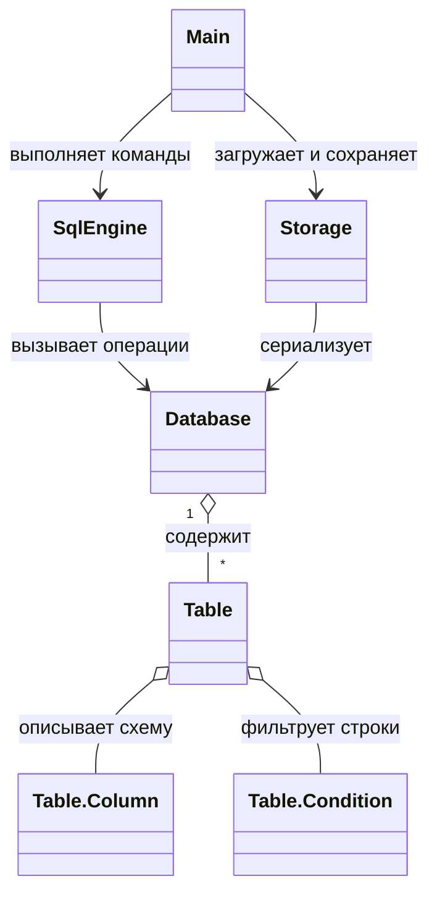
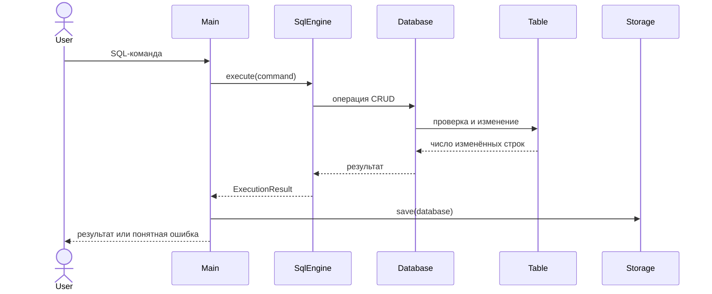

# Simple DBMS

Учебная упрощённая система управления базами данных на Java. Приложение принимает SQL-подобные команды в консоли, проверяет типы и ограничения, сохраняет данные и индексы на диск и восстанавливает их при следующем запуске.

## Возможности

- таблицы со столбцами `INTEGER`, `DOUBLE`, `STRING`, `DATE`, `BOOLEAN`;
- уникальный первичный ключ и внешний ключ между таблицами;
- `INSERT`, `SELECT`, `UPDATE`, `DELETE`;
- дополнительные команды `CREATE TABLE`, `DROP TABLE`, `CREATE INDEX`;
- вставка нескольких строк одной командой;
- табличный вывод результата `SELECT`;
- сохранение после каждого изменения;
- резервная копия и восстановление при повреждении основного файла;
- индексированный поиск по условию равенства.

## Требования и запуск

Нужен JDK 17 или новее и PowerShell 5.1 или новее.

```powershell
.\scripts\build.ps1
.\scripts\run.ps1
```

В интерактивном режиме команда `help` выводит примеры, а `exit` или `quit` завершает работу. Файл базы создаётся в `data/database.bin`. Предыдущая версия хранится в `data/database.bin.bak`, а временный файл атомарного сохранения имеет расширение `.tmp`.

Дополнительные команды разработки:

```powershell
.\scripts\test.ps1
.\scripts\javadoc.ps1
.\scripts\performance.ps1
```

Javadoc создаётся в `out/docs`.

## Предметная область и схема

По умолчанию создаются две связанные таблицы автомобилей:

| Таблица | Столбцы | Первичный ключ | Внешний ключ |
| --- | --- | --- | --- |
| `brands` | `id INTEGER`, `name STRING` | `id` | — |
| `cars` | `id INTEGER`, `brand_id INTEGER`, `model STRING`, `price DOUBLE`, `manufactured DATE`, `available BOOLEAN` | `id` | `brand_id → brands.id` |

Нельзя добавить автомобиль с отсутствующим брендом или удалить бренд, пока на него ссылаются автомобили.

## Примеры команд

```sql
INSERT INTO brands VALUES (1, 'Toyota');
INSERT INTO cars VALUES (1, 1, 'Camry', 25000.0, '2024-05-20', TRUE);
INSERT INTO cars VALUES
  (2, 1, 'Corolla', 18000.0, '2023-03-10', TRUE),
  (3, 1, 'RAV4', 32000.0, '2025-01-15', FALSE);

SELECT * FROM cars;
SELECT model, price FROM cars WHERE price > 20000;
UPDATE cars SET price = 30000 WHERE id = 2;
DELETE FROM cars WHERE id = 1;
CREATE INDEX idx_cars_model ON cars (model);
SELECT * FROM cars WHERE model = 'Corolla';
```

Поддерживаются операторы условий `=`, `!=`, `<`, `<=`, `>`, `>=`. Для `BOOLEAN` допустимы только `=` и `!=`. Строки и даты записываются в одинарных кавычках, дата имеет формат `YYYY-MM-DD`.

Дополнительный синтаксис управления схемой:

```sql
CREATE TABLE notes (id INTEGER PRIMARY KEY, text STRING NOT NULL);
DROP TABLE notes;
```

Удалить можно только пустую таблицу, которая не участвует во внешних ключах.

## Архитектура

Исходный код намеренно оставлен плоским в каталоге `src`:

- `Main` — консольный ввод-вывод и обработка ошибок;
- `SqlEngine` — разбор команд, преобразование литералов и табличный вывод;
- `Database` — управление таблицами и ссылочной целостностью;
- `Table` — строки, схема, CRUD и индексы;
- `Storage` — сериализация, атомарное сохранение и резервное восстановление.



Последовательность изменяющего запроса:



Модель не выполняет консольный ввод-вывод. Все пользовательские ошибки перехватываются в `Main`, поэтому неверное число, дата, тип, имя таблицы или синтаксис запроса не завершают программу аварийно.

## Индексирование и производительность

`CREATE INDEX` строит отображение значения столбца в набор первичных ключей. При `SELECT` с оператором `=` движок получает строки напрямую по ключам. Индексы обновляются после вставки, изменения и удаления, входят в сериализуемое состояние и восстанавливаются вместе с базой.

Замер выполнен командой `.\scripts\performance.ps1` на 50 000 строках. Измерялись 200 запросов по уникальному строковому значению после прогрева JVM:

| Режим | Время 200 запросов |
| --- | ---: |
| Без индекса | 272,795 мс |
| С индексом | 4,061 мс |
| Ускорение | 67,17× |

Абсолютное время зависит от компьютера и состояния JVM, поэтому скрипт позволяет повторить измерение локально.

## Тестирование

Скрипт `scripts/test.ps1` компилирует и запускает самостоятельные проверки без сторонних библиотек. Проверяются типы данных, первичный и внешний ключи, CRUD, актуализация индекса, пакетная вставка, SQL-парсер, консольные ошибки, сериализация и восстановление из `.bak`.

## Структура проекта

- `src` — исходные файлы Java без package-каталогов;
- `test` — функциональные проверки;
- `benchmark` — воспроизводимый тест производительности;
- `scripts` — сборка, запуск, тесты, Javadoc и замер скорости;
- `data` — локальные файлы базы, исключённые из Git;
- `TASK.md` — условие лабораторной работы.

## Ответственность участников

Работа выполняется индивидуально. Проектирование, реализация, тестирование и документация относятся к области ответственности автора работы.

## Выводы

Реализована небольшая СУБД с разделением консольного интерфейса, SQL-обработчика, модели и файлового хранения. Первичные и внешние ключи сохраняют целостность данных, атомарная запись и резервная копия повышают надёжность, а индекс заметно ускоряет точечный поиск.

## Использованные источники

- Oracle Java Documentation: [Object Serialization](https://docs.oracle.com/en/java/javase/17/docs/specs/serialization/)
- Oracle Java Documentation: [java.nio.file.Files](https://docs.oracle.com/en/java/javase/17/docs/api/java.base/java/nio/file/Files.html)
- Oracle Java Documentation: [LocalDate](https://docs.oracle.com/en/java/javase/17/docs/api/java.base/java/time/LocalDate.html)
- PostgreSQL Documentation: [SQL Commands](https://www.postgresql.org/docs/current/sql-commands.html)
